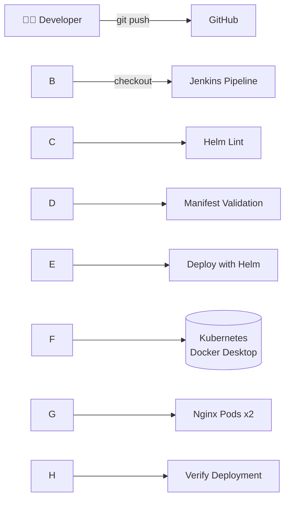

<div align="center">

# 🚀 Nginx on Kubernetes with Helm \& Jenkins CI/CD

## 📑 Table of Contents

* [Overview](#-overview)
* [Project Highlights](#-project-highlights)
* [Architecture](#️-architecture)
* [Project Structure](#-project-structure)
* [Prerequisites](#-prerequisites)
* [Quick Start](#-quick-start)
* [Jenkins Pipeline](#️-jenkins-pipeline)
* [Evidence \& Screenshots](#-evidence--screenshots)
* [Key Results](#-key-results)
* [Troubleshooting](#-troubleshooting)
* [Key Learnings](#-key-learnings)
* [Author](#-author)

\---

## 📖 Overview

This project packages **Nginx** as a reusable **Helm chart** and deploys it to a local **Kubernetes** cluster (Docker Desktop) through a **Jenkins CI/CD pipeline**. Each push to GitHub can be linted, rendered, deployed and verified automatically.

> \*\*Simple • Automated • Reliable\*\*

\---

## ⭐ Project Highlights

* ✅ Build a reusable **Helm chart**
* ✅ Validate with **`helm lint`** and **`helm template`**
* ✅ Deploy using **`helm upgrade --install`**
* ✅ Automate the whole flow with **Jenkins CI/CD**
* ✅ Verify Kubernetes resources after every deployment

\---

## 🏗️ Architecture



\---

## 📁 Project Structure

```
nginx-kubernetes-helm-deployment-project/
│
├── .gitignore               # Ignores sensitive and temporary files
├── README.md                # Project documentation
│
├── myapp/                   # Nginx Helm chart
│   ├── Chart.yaml           # Chart name, version, metadata
│   ├── values.yaml          # Default configurable settings
│   └── templates/
│       ├── \_helpers.tpl     # Reusable template functions
│       ├── configmap.yaml   # Application configuration
│       ├── deployment.yaml  # Nginx pods, image, replicas
│       └── service.yaml     # Network access to the app
│
├── jenkins/
│   └── Jenkinsfile          # CI/CD pipeline definition
│
└── docs/
    └── images/              # Overview graphic and evidence screenshots
```

\---

## 📋 Prerequisites

* Docker Desktop with **Kubernetes enabled**
* `kubectl`, `helm`, `git` and Java (for Jenkins)
* A running Jenkins server with access to this repository

```bash
docker --version
kubectl version --client
helm version
git --version
kubectl get nodes
```

\---

## 🚀 Quick Start

**1. Clone the repository**

```bash
git clone https://github.com/divyadevops14/nginx-kubernetes-helm-deployment-project.git
cd nginx-kubernetes-helm-deployment-project
```

**2. Validate the chart**

```bash
helm lint myapp/
helm template myapp myapp/
```

**3. Deploy with Helm**

```bash
helm upgrade --install myapp myapp/ -n dev --create-namespace
```

**4. Verify the deployment**

```bash
kubectl get pods -n dev
kubectl get deployments -n dev
helm status myapp -n dev
```

**5. Access Nginx**

```bash
kubectl port-forward -n dev service/myapp-myapp 8080:80
```

Open 👉 [http://localhost:8080](http://localhost:8080)

**6. Clean up (optional)**

```bash
helm uninstall myapp -n dev
kubectl delete namespace dev
```

\---

## ⚙️ Jenkins Pipeline

|#|Stage|What it does|
|-|-|-|
|1|**Checkout Code**|Pulls the latest code from GitHub|
|2|**Helm Lint**|Validates chart structure and syntax|
|3|**Manifest Validation**|Renders templates into Kubernetes manifests|
|4|**Deploy with Helm**|Installs or upgrades the release|
|5|**Verify Deployment**|Confirms pods and deployments are healthy|

Pipeline definition: [`jenkins/Jenkinsfile`](jenkins/Jenkinsfile)

\---

## 📸 Evidence \& Screenshots

> Proof that the project works end to end. Images are stored in \[`docs/images/`](docs/images/).

|Step|Screenshot|
|-|-|
|**1. Helm chart validation**|!\[Helm lint and template](docs/images/01-helm-lint-template.png)|
|**2. Helm release deployed**|!\[Helm status](docs/images/02-helm-status.png)|
|**3. Pods and deployments running**|!\[kubectl pods and deployments](docs/images/03-kubectl-pods-deployments.png)|
|**4. Nginx in the browser**|!\[Nginx welcome page](docs/images/04-nginx-browser.png)|
|**5. Jenkins stage view**|!\[Jenkins stage view](docs/images/05-jenkins-stage-view.png)|
|**6. Jenkins successful build**|!\[Jenkins console success](docs/images/06-jenkins-console-success.png)|

\---

## 🏆 Key Results

|Item|Result|
|-|-|
|Helm release|`myapp` ✅ Deployed|
|Namespace|`dev`|
|Replicas|2|
|Pods|2/2 Running|
|Deployment|2/2 Available|
|Jenkins build|✅ Successful|

\---

## 🧰 Troubleshooting

|Problem|Fix|
|-|-|
|`kubectl get nodes` fails|Enable Kubernetes in Docker Desktop and wait until it shows running|
|Jenkins cannot find `helm` or `kubectl`|Add their folders to the system `PATH` and restart the Jenkins service|
|Jenkins cannot reach the cluster|Jenkins running as the SYSTEM account has no kubeconfig; run the service as your user or set `KUBECONFIG`|
|`port-forward` service not found|Run `kubectl get svc -n dev` and use the exact service name|
|Port 8080 already in use|Use another local port, for example `8081:80`|

\---

## 🎓 Key Learnings

* Designing **reusable Helm charts** with templates and values
* Using **`helm lint` and `helm template`** as quality gates before deploying
* Making releases repeatable with **`helm upgrade --install`**
* **Integrating GitHub with Jenkins** for automated pipelines
* **Verifying** Kubernetes resources instead of assuming a deploy worked

\---

## 👩‍💻 Author

### **Divya Mirapakayala**

**DevOps Engineer (Aspiring) | Kubernetes • Helm • Jenkins • Docker • AWS**

I designed, deployed, tested, and debugged this project end to end on a local Kubernetes cluster.

[!\[GitHub](https://img.shields.io/badge/GitHub-divyadevops14-181717?style=for-the-badge\&logo=github)](https://github.com/divyadevops14)
\[📧 Contact Me](mailto:divyamirapakayala1@gmail.com)

<sub>🛠️ Tools used along the way: Claude and ChatGPT as AI assistants for guidance and troubleshooting.</sub>

\---

<div align="center">

**Built with curiosity. Deployed with automation. Ready for production-grade DevOps.**

</div>
