# 🚀 Nginx on Kubernetes with Helm & Jenkins CI/CD

<div align="center">

**Automated application deployment using Kubernetes, Helm, Docker Desktop, and Jenkins.**

[](https://kubernetes.io/)
[](https://helm.sh/)
[](https://www.jenkins.io/)
[](https://www.docker.com/)

</div>

---

## 📑 Table of Contents

- [Overview](#-overview)
- [Project Highlights](#-project-highlights)
- [Architecture](#️-architecture)
- [Project Structure](#-project-structure)
- [Prerequisites](#-prerequisites)
- [Quick Start](#-quick-start)
- [Jenkins CI/CD Pipeline](#️-jenkins-cicd-pipeline)
- [Evidence and Screenshots](#-evidence-and-screenshots)
- [Key Results](#-key-results)
- [Troubleshooting](#-troubleshooting)
- [Key Learnings](#-key-learnings)
- [Author](#-author)

---

## 📖 Overview

This project demonstrates how to package and deploy an Nginx application on a local Kubernetes cluster using Helm and Jenkins.

The application is packaged as a reusable Helm chart. Jenkins automates chart validation, deployment, and verification.

Docker Desktop provides the local Kubernetes environment, while Helm manages the Kubernetes application resources.

**Simple • Automated • Repeatable**

---

## ⭐ Project Highlights

- ✅ Created a reusable Helm chart for Nginx.
- ✅ Used `helm lint` to validate the chart.
- ✅ Used `helm template` to render Kubernetes manifests.
- ✅ Deployed the application using `helm upgrade --install`.
- ✅ Configured a Jenkins pipeline for deployment automation.
- ✅ Verified Kubernetes pods, deployments, and services.
- ✅ Accessed the deployed Nginx application through port forwarding.

---

## 🏗️ Architecture

```mermaid
flowchart LR
    A[Developer] -->|Git Push| B[GitHub]
    B -->|Checkout| C[Jenkins Pipeline]
    C --> D[Helm Lint]
    D --> E[Deploy with Helm]
    E --> F[Kubernetes Cluster]
    F --> G[Nginx Deployment]
    G --> H[Two Nginx Pods]
    H --> I[Verify Deployment]
    I --> J[Nginx Welcome Page]
```



---

## 📁 Project Structure

```text
nginx-kubernetes-helm-deployment-project/
│
├── .gitignore
├── README.md
│
├── myapp/
│   ├── Chart.yaml
│   ├── values.yaml
│   └── templates/
│       ├── _helpers.tpl
│       ├── configmap.yaml
│       ├── deployment.yaml
│       └── service.yaml
│
├── jenkins/
│   └── Jenkinsfile
│
└── project-evidence-with-summary/
    └── evidence/
        ├── 01-project-overview.svg
        ├── 02-docker-desktop-kubernetes-cluster.jpg
        ├── 03-helm-chart-validation-and-install.jpg
        ├── 04-helm-deployment-status-and-pods.jpg
        ├── 05-jenkins-pipeline-success.jpg
        ├── 06-nginx-welcome-page.jpg
        ├── README.md
        └── DEPLOYMENT_EVIDENCE_SUMMARY.md
```

---

## 📋 Prerequisites

Make sure the following tools are installed:

- Docker Desktop with Kubernetes enabled.
- `kubectl`
- Helm
- Git
- Java and Jenkins.

Check the installations:

```bash
docker --version
kubectl version --client
helm version
git --version
kubectl get nodes
```

---

## 🚀 Quick Start

### 1. Clone the repository

```bash
git clone https://github.com/divyadevops14/nginx-kubernetes-helm-deployment-project.git

cd nginx-kubernetes-helm-deployment-project
```

### 2. Validate the Helm chart

```bash
helm lint myapp/
```

Render the Kubernetes manifests:

```bash
helm template myapp myapp/
```

### 3. Deploy the application

```bash
helm upgrade --install myapp myapp/ -n dev --create-namespace
```

### 4. Verify the deployment

Check the pods:

```bash
kubectl get pods -n dev
```

Check the deployment:

```bash
kubectl get deployments -n dev
```

Check the service:

```bash
kubectl get services -n dev
```

Check Helm release status:

```bash
helm status myapp -n dev
```

### 5. Access the Nginx application

Run:

```bash
kubectl port-forward -n dev service/myapp-myapp 8080:80
```

Open the following URL in your browser:

http://localhost:8080

You should see the Nginx welcome page.

### 6. Clean up (optional)

Uninstall the Helm release:

```bash
helm uninstall myapp -n dev
```

Delete the namespace if it is no longer needed:

```bash
kubectl delete namespace dev
```

---

## ⚙️ Jenkins CI/CD Pipeline

The Jenkins pipeline automates the Helm deployment workflow.

| Stage | Description |
|---|---|
| Declarative Checkout SCM | Checks out the source code |
| Checkout | Prepares the project files |
| Lint Helm Chart | Validates the Helm chart |
| Deploy with Helm | Installs or upgrades the application |
| Verify | Checks the Kubernetes deployment |

**Pipeline file:** [`jenkins/Jenkinsfile`](jenkins/Jenkinsfile)

The pipeline can be triggered manually or through an SCM trigger when configured.

---

## 📸 Evidence and Screenshots

The following screenshots and project evidence demonstrate the deployment workflow.

All evidence files are available in [`project-evidence-with-summary/evidence/`](project-evidence-with-summary/evidence/).

| Step | Evidence |
|---|---|
| Project overview | [01 - Project Overview](project-evidence-with-summary/evidence/01-project-overview.svg) |
| Kubernetes cluster | [02 - Docker Desktop Kubernetes](project-evidence-with-summary/evidence/02-docker-desktop-kubernetes-cluster.jpg) |
| Helm validation | [03 - Helm Chart Validation and Install](project-evidence-with-summary/evidence/03-helm-chart-validation-and-install.jpg) |
| Deployment status | [04 - Helm Deployment Status and Pods](project-evidence-with-summary/evidence/04-helm-deployment-status-and-pods.jpg) |
| Jenkins pipeline | [05 - Jenkins Pipeline Success](project-evidence-with-summary/evidence/05-jenkins-pipeline-success.jpg) |
| Nginx application | [06 - Nginx Welcome Page](project-evidence-with-summary/evidence/06-nginx-welcome-page.jpg) |

For detailed explanations, see [DEPLOYMENT_EVIDENCE_SUMMARY.md](project-evidence-with-summary/evidence/DEPLOYMENT_EVIDENCE_SUMMARY.md).

---

## 🏆 Key Results

| Component | Result |
|---|---|
| Application | Nginx |
| Deployment tool | Helm |
| Kubernetes environment | Docker Desktop |
| Helm release | `myapp` |
| Namespace | `dev` |
| Replicas | 2 |
| Pods | 2/2 Running |
| Deployment | 2/2 Available |
| Jenkins pipeline | Successful |
| Application access | Nginx Welcome Page |

---

## 🧰 Troubleshooting

| Problem | Possible Solution |
|---|---|
| `kubectl get nodes` fails | Check whether Kubernetes is enabled and running in Docker Desktop. |
| Jenkins cannot find Helm | Add the Helm installation directory to the system PATH. |
| Jenkins cannot find kubectl | Add the kubectl installation directory to the system PATH. |
| Jenkins cannot access Kubernetes | Check the Jenkins service account and its kubeconfig configuration. |
| Helm release not found | Check the namespace using `helm list -A`. |
| Service not found | Run `kubectl get svc -n dev` and check the service name. |
| Port 8080 already in use | Use another local port, such as `8081:80`. |

---

## 🎓 Key Learnings

Through this project, I learned:

- How to create reusable Helm charts using templates and values.
- How to validate Helm charts using `helm lint`.
- How to render Kubernetes manifests using `helm template`.
- How to deploy applications using `helm upgrade --install`.
- How to manage Kubernetes Deployments, Pods, and Services.
- How to integrate GitHub with Jenkins.
- How to automate application deployment using a Jenkins pipeline.
- How to verify application deployment and troubleshoot issues.

---

## 👩‍💻 Author

### Divya Mirapakayala

**Aspiring DevOps Engineer**

Technologies: Kubernetes | Helm | Jenkins | Docker | AWS | Terraform

I designed, deployed, tested, and troubleshot this project using a local Kubernetes environment.

[](https://github.com/divyadevops14)

📧 [Contact Me](mailto:divyamirapakayala1@gmail.com)

<sub>AI assistants, including ChatGPT and Claude, were used for learning guidance and troubleshooting support.</sub>

---

<div align="center">

**Built with curiosity. Deployed with automation.**

</div>
